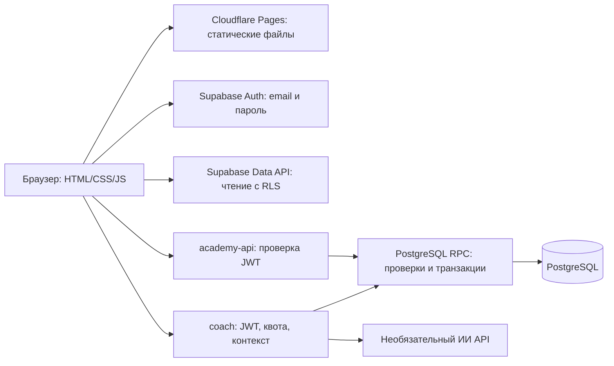

# Архитектура и безопасность

## Таблицы и права

- `auth.users` — аккаунты; Auth хранит хеши и управляет подтверждением, токенами и восстановлением.
- `profiles`, `app_roles` — профиль и отдельная роль. Роль не берётся из user metadata. `banned` блокирует защищённые операции.
- `licenses`, `courses`, `lessons`, `assignments`, `achievements` — опубликованный каталог, доступный для чтения.
- `lesson_progress`, `assignment_submissions`, `practice_attempts`, `tutor_messages`, `user_achievements`, `user_licenses` — только владелец активного аккаунта и администраторы.
- `exams`, `exam_questions`, `exam_attempts`, `exam_answers` — определения, вопросы, снимки и ответы. Экзаменационный банк читают только администраторы; студент получает вопросы своей попытки без ключей.
- `academy_settings`, `admin_audit` — настройки и журнал. Журнал виден только администраторам.
- `private.lesson_keys`, `private.exam_keys`, `private.attempt_keys`, `private.tutor_usage` — нет SELECT/UPDATE для anon и authenticated; private не публикуется в Data API.

Во всех таблицах приложения включён RLS. У authenticated нет прямых прав INSERT/UPDATE/DELETE на таблицы: изменения выполняются только через `public.academy`. Эта SECURITY DEFINER функция использует пустой `search_path`, квалифицированные имена объектов, `auth.uid()`, проверку блокировки и роль администратора для каждого admin-действия. PUBLIC и anon не могут её исполнять. Прямой RPC-вызов также проверяется: Edge Function не является единственным барьером.

## Учебный прогресс

`save_lesson` сохраняет только черновик: присланный `completed` не влияет на флаг завершения. `submit_lesson` проверяет порядок уроков, ключи вопросов, координаты 11 игроков, давление, ширину, стиль, число игроков в верхней трети и длину объяснения. Для Pro требуется план замены. Завершение и достижения записываются сервером.

Критерии практики — открытая учебная рубрика, не защита от списывания. Проверка длины и ключевых слов не понимает смысла текста. Поэтому официальные письменные работы оценивает человек.

## Экзамены

- Предыдущая лицензия и все уроки уровня обязательны; не более 3 официальных попыток за 24 часа, одна незавершённая/ожидающая проверки на уровень.
- Вопросы, варианты, рубрики и ключи копируются в неизменяемый снимок попытки. Правки банка не меняют уже начатый экзамен.
- Нельзя передать баллы из браузера. Теория рассчитывается сервером, обязательны все 20 ответов и 3 текста от 80 слов.
- После отправки ответы неизменяемы. Практика — ручная очередь, 4 критерия 0–5 для каждой из 3 задач. Обязателен письменный отзыв.
- Администратор не проверяет свою работу. При ≥70/100 лицензия и достижение выдаются в одной транзакции с оценкой и аудитом. Повторная проверка не выдаст второй сертификат.
- Ручная выдача/отзыв требует администратора и причины от 20 символов, фиксируется в аудите.

Поставляемый банк — учебное стартовое наполнение. Если репозиторий GitHub публичный, его seed-вопросы и ответы видны в исходниках; перед реальной аттестацией создайте/замените закрытый банк через админ-панель. Не храните рабочий экзаменационный банк в публичном Git.

## Клиент и ключи

Только публичные URL и publishable/anon key в `VITE_*`. Права обеспечиваются Auth/RLS, не скрытием публичного ключа. Секретный ключ ИИ существует только в Edge Function Secrets. Edge Function не принимает от клиента адрес API, модель или системный prompt.

Вывод пользовательского/администраторского текста экранируется перед вставкой HTML; формат уроков — обычный текст, не исполняемый HTML/Markdown. Для Pages заданы CSP, запрет iframe, nosniff и ограничения устройств. Не подключаются внешние шрифты/трекеры. Небезопасный пользовательский HTML не поддерживается.

Supabase SDK сохраняет сессию в браузере. Отдельного локального хранилища прогресса нет. Чужие данные можно увидеть только с явной ролью администратора, необходимой для учебного контроля. Владельцу проекта следует ограничивать круг администраторов и настроить свои правила хранения/удаления данных. Удаление пользователя через Supabase Auth каскадно удаляет профиль и связанные личные записи, кроме ссылок рецензента в уже проверенных экзаменах: такие аккаунты сначала архивируйте согласно вашей политике.

## ИИ

Режим по умолчанию — подготовленный, без внешнего API. Свободный ИИ-диалог требует активного аккаунта и серверной квоты. Время вызова и размер ответа ограничены. ИИ не имеет service-role key, не проверяет официальные экзамены, не изменяет таблицы лицензий и не исполняет инструменты. История и текст обучающегося передаются как недоверенный контекст; возможные ошибки ИИ не считаются официальной оценкой.
